# ERD: schema bazei de date

Generat din migrațiile rulate pe MySQL 8.4 (`php artisan migrate --pretend`),
la 2026-10-29. Sunt afișate doar coloanele cheie; tabelele framework-ului
(`cache`, `jobs`, `sessions`, `password_reset_tokens`, `failed_jobs`) și
tabelele pachetelor (Spatie: `roles`, `permissions`, `model_has_*`,
`role_has_permissions`, `activity_log`, `media`) nu sunt desenate integral.

## Diagrama

```mermaid
erDiagram
    users {
        bigint id PK
        string email UK
        string phone
        boolean is_active
        timestamp deleted_at
    }
    brands {
        bigint id PK
        string slug UK
    }
    categories {
        bigint id PK
        bigint parent_id FK
        string slug UK
    }
    products {
        bigint id PK
        char ulid UK
        bigint brand_id FK
        string slug UK
        string status
        timestamp published_at
        timestamp deleted_at
    }
    product_variants {
        bigint id PK
        bigint product_id FK
        string sku UK
        bigint price
        int stock_on_hand
        int stock_reserved
        int low_stock_threshold
        boolean track_inventory
        boolean allow_backorder
    }
    attributes {
        bigint id PK
        string slug UK
    }
    attribute_values {
        bigint id PK
        bigint attribute_id FK
    }
    product_attribute_values {
        bigint id PK
        bigint product_id FK
        bigint product_variant_id FK "nullable"
        bigint attribute_value_id FK
    }
    carts {
        bigint id PK
        char ulid UK
        bigint user_id FK "nullable"
        bigint coupon_id FK "nullable"
    }
    cart_items {
        bigint id PK
        bigint cart_id FK
        bigint product_variant_id FK
        int quantity
        bigint unit_price_snapshot
    }
    coupons {
        bigint id PK
        string code UK
        string type
        bigint value
    }
    coupon_usages {
        bigint id PK
        bigint coupon_id FK
        bigint user_id FK "nullable"
        bigint order_id FK "nullable"
    }
    orders {
        bigint id PK
        string number UK
        string idempotency_key UK
        bigint user_id FK "nullable"
        string status
        string payment_status
        bigint grand_total
        json billing_address
        json shipping_address
        timestamp deleted_at
    }
    order_items {
        bigint id PK
        bigint order_id FK
        bigint product_variant_id FK "nullable"
        string name
        string sku
        bigint unit_price
        int tax_rate_bps
        int quantity
    }
    payments {
        bigint id PK
        bigint order_id FK
        string provider
        string provider_reference
        string status
        bigint amount
    }
    stock_reservations {
        bigint id PK
        bigint product_variant_id FK
        bigint cart_id FK "nullable"
        bigint order_id FK "nullable"
        int quantity
        timestamp expires_at
        timestamp released_at
    }
    inventory_movements {
        bigint id PK
        bigint product_variant_id FK
        string type
        int quantity
        int balance_after
        string reference_type "morph"
        bigint reference_id "morph"
        bigint created_by FK "nullable"
    }
    tax_rates {
        bigint id PK
        int rate_bps
        char country
    }
    shipping_zones {
        bigint id PK
        json countries
    }
    shipping_methods {
        bigint id PK
        bigint shipping_zone_id FK
    }
    shipping_rates {
        bigint id PK
        bigint shipping_method_id FK
        bigint min_subtotal
        bigint max_subtotal
        bigint price
    }

    brands |o--o{ products : "marcă"
    categories |o--o{ categories : "părinte"
    categories }o--o{ products : "category_product"
    products ||--|{ product_variants : "variante"
    attributes ||--o{ attribute_values : "valori"
    products ||--o{ product_attribute_values : ""
    product_variants |o--o{ product_attribute_values : ""
    attribute_values ||--o{ product_attribute_values : ""
    users |o--o{ carts : "deține"
    coupons |o--o{ carts : ""
    carts ||--o{ cart_items : "linii"
    product_variants ||--o{ cart_items : ""
    coupons ||--o{ coupon_usages : ""
    users |o--o{ coupon_usages : ""
    orders |o--o{ coupon_usages : ""
    users |o--o{ orders : "plasează"
    orders ||--|{ order_items : "linii"
    product_variants |o--o{ order_items : "snapshot"
    orders ||--o{ payments : ""
    product_variants ||--o{ stock_reservations : ""
    carts |o--o{ stock_reservations : ""
    orders |o--o{ stock_reservations : ""
    product_variants ||--o{ inventory_movements : "ledger"
    users |o--o{ inventory_movements : "created_by"
    shipping_zones ||--o{ shipping_methods : ""
    shipping_methods ||--o{ shipping_rates : ""
```

Relații polimorfice active (morph map impus în `AppServiceProvider`):
`activity_log` (subject, causer), `media` (model), `model_has_roles` /
`model_has_permissions` (model), `inventory_movements` (reference).
Aliasuri: `user`, `product`, `product_variant`, `category`, `brand`, `cart`, `order`.

## Audit de schemă

| # | Constatare | Severitate | Acțiune propusă |
|---|---|---|---|
| 1 | `carts.user_id` nu are index unic. `firstOrCreate` pe `user_id` poate crea două coșuri pentru același utilizator la cereri simultane | De reparat | Migrație: `unique('user_id')` (MySQL permite mai multe NULL, deci coșurile de invitat nu sunt afectate) |
| 2 | `products.slug` și `users.email` sunt unice, dar tabelele au `deleted_at`. Un rând șters logic blochează refolosirea valorii | De decis | Păstrezi comportamentul (restaurare) sau muți unicitatea pe `(slug, deleted_at)` |
| 3 | `orders.status`, `payment_status`, `fulfillment_status` sunt `enum` în baza de date, dar `payments.status` este `varchar(32)`. Un status nou cere migrație pe `orders` | Ok / de uniformizat | La Etapa 5, treci coloanele de status pe `varchar` validat de enum-urile PHP |
| 4 | `order_items` și `payments` nu au `currency` pe linie (`payments` are). `MoneyCast` presupune RON pe `order_items` | Ok cât ai o singură monedă | Adaugă `currency` la `order_items` când introduci a doua monedă |
| 5 | `product_attribute_values`: `UNIQUE (product_id, attribute_value_id, product_variant_id)` nu împiedică dubluri când `product_variant_id` este NULL (MySQL tratează NULL ca distinct) | Mic | Previi dublurile în cod (`syncWithoutDetaching`) sau separi în două tabele |
| 6 | `coupon_usages` nu are unic pe `order_id` | Mic | `unique('order_id')`, o comandă folosește cel mult un cupon |
| 7 | `categories.path` nu este indexat | Mic | Index când se fac căutări pe prefix |
| 8 | Toate coloanele de bani sunt `bigint unsigned` (unități minore); cotele sunt `int` în puncte de bază | Ok | |
| 9 | Toate cheile străine sunt indexate (InnoDB creează automat indexul) | Ok | |
| 10 | Morph map-ul nu acoperă încă `coupon`, `role`, `permission`, `shipping_method`, `media` | Mic | Extinde-l când activezi audit log pe aceste modele (Etapa 6) |

## Tabele planificate care nu există încă

`addresses`, `tags` / `taggables`, `reviews`, `order_status_histories`,
`order_notes`, `refunds`, `shipments` / `shipment_items`, `invoices`,
`webhook_events`, `low_stock_alerts`, `settings`, `daily_sales_stats`,
`product_daily_stats`, `suppliers` / `purchase_orders`.
